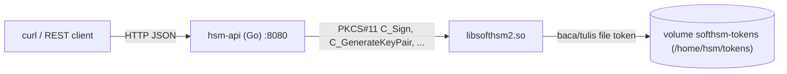

# Arsitektur

## Tujuan

Menyediakan layanan kriptografi (signing + key management) berbasis HSM
*software* SoftHSM2 melalui antarmuka PKCS#11, dalam satu image/container.

## Komponen (di dalam satu container)

| Komponen | Teknologi | Fungsi |
|---|---|---|
| SoftHSM2 | `libsofthsm2.so` | Modul PKCS#11 (penyimpan token & kunci) |
| `hsm-api` | Go + `net/http` + `miekg/pkcs11` | REST API signing/key management |
| `entrypoint.sh` | shell | Init token saat run pertama, lalu jalankan `hsm-api` |
| volume `softhsm-tokens` | Docker named volume | Persistensi token & kunci antar restart |

## Diagram alur

Semuanya berjalan di dalam satu container `hsm`. Kunci tidak pernah keluar dari
token (private key bertanda `never extractable`).

## Konsep PKCS#11

| Istilah | Makna di proyek ini |
|---|---|
| **Module** | `libsofthsm2.so` — library yang di-load saat runtime |
| **Slot** | Satu "reader" token; SoftHSM2 punya beberapa slot |
| **Token** | `mytoken` — penyimpan kriptografi yang dilindungi PIN |
| **Session** | Koneksi login ke token untuk operasi |
| **Object** | Key, sertifikat, data (diidentifikasi `CKA_LABEL` / `CKA_ID`) |
| **PIN** | `1234` (user) — autentikasi akses token |

## Model keamanan & batasan

**Aman di lingkungan lokal/CI:**

- Kunci disimpan dalam file yang dienkripsi (backend `file` + PIN).
- Private key tidak bisa diekspor (`CKA_SENSITIVE`, `CKA_EXTRACTABLE=false`).
- Operasi kripto dieksekusi di dalam modul, bukan di aplikasi.

**Bukan pengganti HSM produksi:**

- Tidak ada perlindungan fisik / anti-tamper.
- Tidak bersertifikat FIPS 140 / Common Criteria.
- PIN adalah satu-satunya lapisan autentikasi; file token bisa dicuri lalu
  di-brute-force offline.
- Untuk produksi gunakan HSM hardware (Thales, Utimaco, Entrust) atau cloud
  HSM (AWS CloudHSM, Azure Managed HSM, GCP KMS).

## Alur operasi (contoh sign)

1. Klien `POST /api/v1/sign` (label kunci + data base64).
2. `hsm-api` membuka session (`C_OpenSession`) dan login (`C_Login`) ke token.
3. `hsm-api` mencari object private key via `C_FindObjects` (label).
4. `hsm-api` memanggil `C_Sign` (hash + tanda tangan) di dalam modul.
5. Signature dikembalikan ke klien; session ditutup.

Session dibuat **per request** (`withSession`) agar aman untuk banyak request
bersamaan (concurrency).

## Build (multi-stage)

`Dockerfile` memakai dua stage:

1. **builder** (`golang:1.26-bookworm`) — compile `hsmservice/` menjadi binary `hsm-api`.
2. **runtime** (`debian:bookworm-slim`) — install SoftHSM2 + tooling, salin
   binary `hsm-api`, config, dan entrypoint.

Hasilnya satu image `hsm-service:local` yang berisi keduanya.
